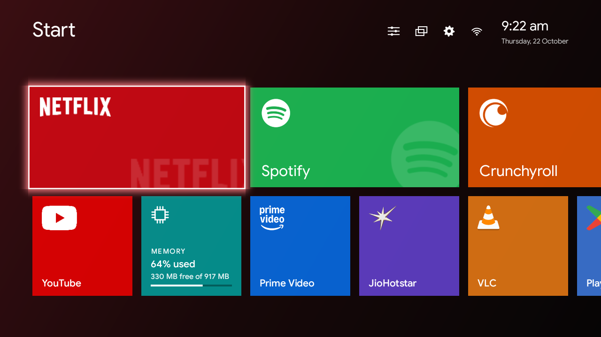
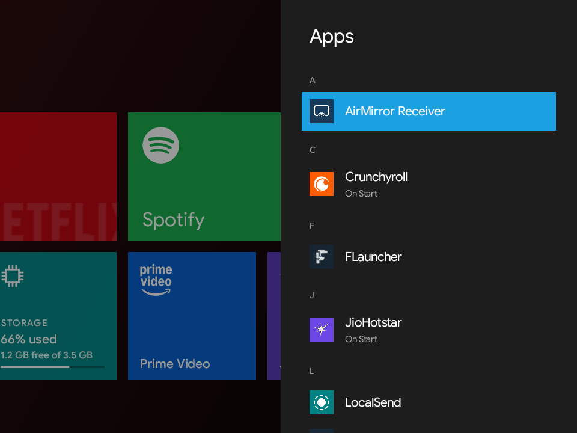
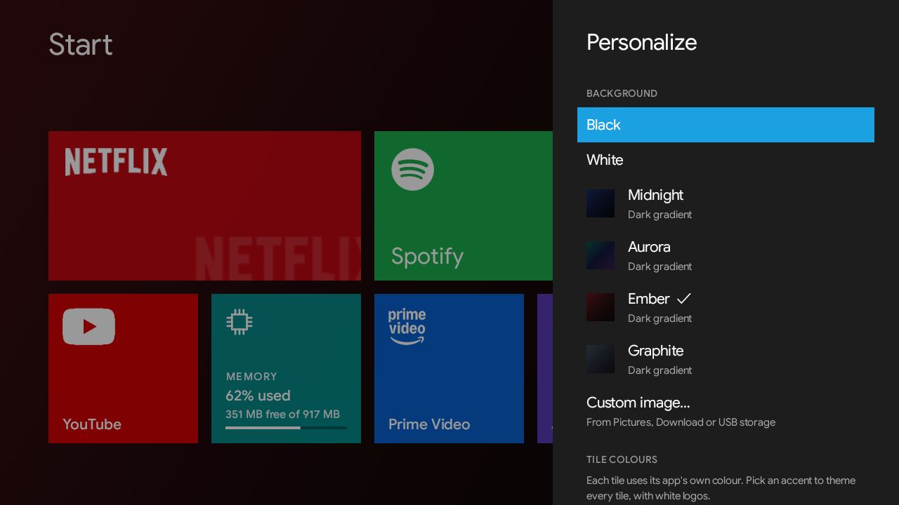

# Metro: a Windows 8 style launcher for Android TV

A tiny, fast home screen for Android TV that brings back the Windows 8 Start screen: big flat live tiles, the turnstile app-opening animation, and accent colours. The whole app is about **50 KB**.



## Features

- **Big Metro tiles** in three sizes: Small (1×1), Wide (2×1) and Large (2×2). Each tile takes its app's own colour, with the logo sitting directly on it.
- **Live tiles.** Media apps show what's playing or was played last (title, artist or channel, progress) over the album cover or video thumbnail, and a System tile flips between RAM and storage use.
- **Windows 8 animations.** Tiles swing away in a turnstile and the app's colour zooms up when you open something; tiles fly back in when you return.
- **Themes:** Black, White, four dark gradients (Midnight, Aurora, Ember, Graphite), or your own image. Pick one of the 20 Windows 8 accent colours to theme every tile with white logos that keep their cut-out details.
- **Start menu.** Select "Start" for every app in alphabetical order, and pin or unpin any of them.
- **Status bar** with Voice search (Google Assistant), Personalize, Recent apps, Settings and Wi-Fi shortcuts, plus the time. The remote's search button opens the assistant too.
- **Close apps:** close background apps one at a time from Recent apps, or all at once.
- **No internet access.** The app doesn't request the internet permission, so nothing you do leaves your TV.

| Apps list | Personalize |
|---|---|
|  |  |

## Requirements

- An Android TV or Google TV running **Android 5.0 or newer**. It was built and tested on a TCL TV running Android 11 (1280×720); other TVs should work but haven't been tested yet.
- A remote with arrow keys, OK, Back, Home and Menu.

## Install

### 1. Get the APK onto your TV

Download `metro-launcher.apk` from the [latest release](../../releases/latest). Then pick whichever of these suits you.

**Option A, no computer (recommended):**

1. On the TV, install **Downloader by AFTVnews** from the Google Play Store.
2. Open Downloader and enter this address:
   ```
   https://github.com/loneelephant32-lang/metro-tv-launcher/releases/latest/download/metro-launcher.apk
   ```
3. When Android asks, allow Downloader to **install unknown apps**, then tap **Install**.

**Option B, USB drive or file sharing:** copy the APK to a USB drive (or use an app like *Send Files to TV*), open it with a file manager on the TV, and allow installing unknown apps when asked.

**Option C, from a computer with adb:** see [Using adb](#using-adb) below, then run:
```bash
adb install metro-launcher.apk
```

### 2. Make Metro your home screen

Android TV doesn't always ask which home screen to use, so try these in order:

1. **Press Home.** If your TV shows a list of home apps, choose **Metro** and pick *Always*.
2. **Check Settings.** Some TVs have *Settings → Apps → Default apps → Home app*.
3. **Use adb** (works on most TVs):
   ```bash
   adb shell cmd package set-home-activity com.metro.launcher/.StartActivity
   ```
   On one TCL TV this command made the system restart itself once (it came back fine); if that happens, wait a minute and run it again.
4. **Last resort:** turn off the TV's built-in launcher so Metro becomes the only home app. This is reversible, but do it only if the steps above don't work:
   ```bash
   # Android TV
   adb shell pm disable-user --user 0 com.google.android.tvlauncher
   # Google TV
   adb shell pm disable-user --user 0 com.google.android.apps.tv.launcherx
   ```
   To undo it, run the same command with `pm enable` instead of `pm disable-user --user 0`.

### 3. Turn on live tiles and Recent apps (optional, recommended)

Live tiles need to read what apps are playing, and Recent apps needs to see which apps you used. Metro works without them, but those tiles stay plain.

On TVs that have them, allow both in *Settings → Apps → Special app access*: **Notification access** and **Usage access**, for Metro. Otherwise use adb:

```bash
adb shell cmd notification allow_listener com.metro.launcher/com.metro.launcher.MediaListener
adb shell appops set com.metro.launcher GET_USAGE_STATS allow
```

A custom background image asks for photo/storage permission the first time you pick one.

### Using adb

1. On the TV, open *Settings → Device Preferences → About* and select **Build** seven times to unlock developer options.
2. In *Settings → Device Preferences → Developer options*, turn on **USB debugging** (and **Network debugging** if your TV has it).
3. Find the TV's IP address in *Settings → Network & Internet*.
4. Install [Android platform tools](https://developer.android.com/tools/releases/platform-tools) on your computer, then run:
   ```bash
   adb connect TV_IP_ADDRESS:5555
   ```
   and accept the prompt that appears on the TV.

## Using it

| On the remote | What it does |
|---|---|
| Arrows | Move between tiles |
| OK | Open the app |
| **Menu**, or hold OK | Tile menu: move, size, colour, pause/resume media, close, unpin |
| Arrows, while moving a tile | Carry it left, right, up or down; OK when done |
| Up, to the top bar | Reach **Start** (all apps) and the status icons |
| Menu on an app in the Start list | Pin to Start or unpin |
| Back | Close the open panel |
| Home | Back to the first tile |

**Personalize** (sliders icon in the top bar) has backgrounds, tile colours, animations, the System tile and *Reset Start*.

## Updating

Install the newer APK the same way. Updates install over the old version and keep your tiles and settings, as long as both came from this repository's releases.

## Uninstall

*Settings → Apps → Metro → Uninstall*, or `adb uninstall com.metro.launcher`. If you turned off your TV's built-in launcher, turn it back on first (see step 2.4).

## Good to know

- **Live tiles depend on the app.** Metro shows what an app chooses to share with the TV. On the test TV, Spotify and YouTube share the title and a cover or thumbnail; JioHotstar shares the title but no picture; Netflix shares nothing, so its tile stays plain. Pictures only available as a web link aren't loaded, because Metro has no internet access.
- **"Close app" only stops apps running in the background.** Fully force-stopping other apps needs system privileges that no launcher has.
- **Music stopping after you press Home isn't caused by the launcher.** Some TVs, TCL models in particular, freeze or kill background apps to save memory; on the test TV Android itself killed Spotify's background service. Other launchers behave the same there.
- **How smooth it feels depends on your TV.** Budget TV graphics chips may run around 30–50 fps; the launcher avoids needless redraws to make the most of them.
- Metro uses your TV's built-in **Google Sans** font when it's there, and falls back to the system font otherwise.

## Build from source

You need JDK 17 or newer and the Android SDK (platform 36). Then:

```bash
./gradlew assembleRelease
```

The APK is written to `app/build/outputs/apk/release/`. Without a signing key it's signed with your local debug key, which is fine for installing on your own TV.

**Maintainers signing official releases:** put a `keystore.properties` file in the project root (it's git-ignored):

```properties
storeFile=/absolute/path/to/metro-release.jks
storePassword=...
keyAlias=metro
keyPassword=...
```

Keep that keystore safe. Releases signed with a different key can't update existing installs.

## License

[MIT](LICENSE). Not affiliated with or endorsed by Microsoft; "Windows" and "Metro" are used only to describe the design style. App names and logos shown on tiles belong to their owners.
